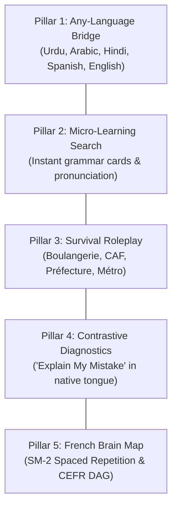

# Deliverable 01 — Product Vision

**Product**: Bienvenue  
**Sub-title**: French in the language you understand  
**Document Owner**: Head of Product / Product Management  
**Status**: Approved & Baseline  

---

## 1. Executive Vision Statement

> **"To make the French language instantly accessible, intuitive, and dignity-affirming to anyone in the world, rooted directly in the language and mental models they already speak."**

For decades, learning French has imposed an unspoken barrier: the **English Intermediary Tax**. If an Urdu speaker in Lahore, an Arabic speaker in Casablanca, or a Hindi speaker in Delhi wishes to learn French, modern educational apps and textbooks demand that they first translate their thoughts into English or navigate English grammatical explanations before reaching French.

**Bienvenue dissolves this intermediary.** By engineering a direct contrastive bridge between French and the learner's native tongue, Bienvenue anchors French phonetics, verb conjugations, and cultural survival patterns directly onto the learner’s native syntax and lived experience.

---

## 2. Core Product Principles

### I. The Native-First Rule (Zero English Leakage)
Every explanation, error correction, and nuance guide must be delivered in the learner's selected native language. If a learner chooses Urdu (اردو), the system must never default to English explanations when dealing with edge cases. The UI, script typography, and cognitive parallels remain 100% native.

### II. Pedagogy Before Gamification
While competitors prioritize cartoon streaks, leaderboards, and repetitive multiple-choice taps that create the illusion of learning, Bienvenue prioritizes **active recall, conversational confidence, and practical linguistic survival**. Gamification is only used to reinforce retention (Spaced Repetition SM-2), not to distract from substance.

### III. Life Situations Over Tourist Trivia
A learner preparing for Paris or Montreal does not need to spend their first month learning that *"the owl is eating an apple"*. They need to navigate:
- The CAF (housing subsidies) and Préfecture (residence permits)
- Signing an apartment lease and speaking to a landlord (*le propriétaire*)
- Explaining symptoms to a doctor or pharmacist
- Buying the right metro pass without getting fined

### IV. Contrastive Linguistic Intelligence
Languages are not isolated dictionaries; they have structures. Bienvenue's engine understands *why* a speaker makes a mistake:
- Urdu speakers naturally place verbs at the end of sentences (SOV). Bienvenue highlights the shift to SVO in French.
- Arabic speakers omit copula verbs in present nominal sentences. Bienvenue alerts them that French strictly requires *être*.
- Hindi speakers understand honorifics (*आप vs तुम/तू*). Bienvenue connects this directly to *Vous vs Tu*, a nuance native English speakers perpetually struggle to grasp.

### V. Radical Accessibility & Free Core
Language acquisition is a catalyst for economic mobility, asylum integration, and academic opportunity. The fundamental core curriculum (CEFR A1 and A2), search dictionary, and contrastive grammar guides must remain **free forever**.

---

## 3. The 5 Strategic Pillars

1. **Direct Native Bridge**: Expanding from 5 beachhead languages to 100+ over 3 years, building a proprietary cross-linguistic pedagogical dataset.
2. **Search-as-a-Gateway**: Making vocabulary search addictive. Instead of a sterile dictionary, searching a word generates an actionable Micro-Learning Card with native transliteration, contrastive rules, and a 1-tap speaking challenge.
3. **High-Stakes Survival Scenarios**: Practical interactive roleplays that test real-world readiness for newcomers, students, and job seekers.
4. **Contrastive Error Intelligence**: Real-time diagnostic feedback explaining the exact cognitive interference between L1 (native language) and L2 (French).
5. **The French Brain Map**: A transparent, competency-based knowledge graph that tracks individual mastery decay across recognition, recall, listening, and speaking.

---

## 4. Multi-Script Brand Identity & Positioning

| Language | Localized Tagline | Visual Script Direction |
|---|---|---|
| **English** | *French, in your language. Learn French without learning English first.* | Left-to-Right (LTR) |
| **Urdu (اردو)** | *فرانسیسی سیکھیں، اپنی زبان میں — بغیر انگریزی کے سہارے۔* | Right-to-Left (RTL) |
| **Arabic (العربية)** | *تعلّم الفرنسية بلغتك الأم — دون الحاجة للغة وسيطة.* | Right-to-Left (RTL) |
| **Hindi (हिन्दी)** | *अपनी मातृभाषा में फ़्रेंच सीखें — बिना अंग्रेजी के सहारे।* | Left-to-Right (LTR) |
| **Spanish (Español)** | *Aprende francés en tu propio idioma, de forma natural y directa.* | Left-to-Right (LTR) |

---

## 5. Strategic North Star & 3-Year Vision

In Year 1, Bienvenue establishes itself as the premier French learning tool for South Asian and Middle Eastern immigrants, university students, and TEF/TCF exam candidates.

In Year 3, Bienvenue transforms from a French application into the **World's Multilingual Language Architecture**:
$$\text{Any Source Language} \xrightarrow{\quad\text{Contrastive Engine}\quad} \text{Any Target Language (French, German, Spanish, Japanese)}$$
Turning the proprietary cross-linguistic error dataset into an insurmountable educational moat.
