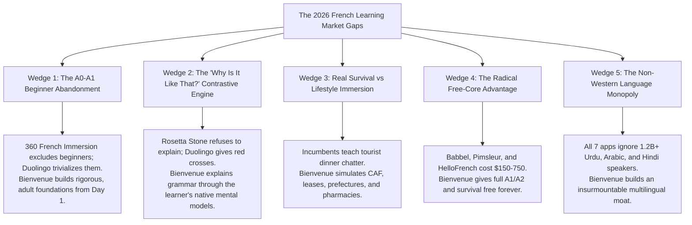

# Deliverable 02 — Market & Competitor Analysis

**Product**: Bienvenue  
**Focus**: Global French Language Learning Landscape & Deep 7-Competitor Gap Analysis  
**Status**: Approved & Baseline (Updated with 2026 Competitive Intelligence)  

---

## 1. Executive Industry Overview

The global digital language learning market is projected to surpass **\$32 Billion by 2030**, growing at a CAGR of 18.8%. French remains the **second most learned foreign language globally** after English, driven by:
- France’s status as Europe's top destination for foreign direct investment, tech talent, and university exchange.
- Canada's aggressive Express Entry points incentives for French-speaking immigrants (TEF Canada / TCF Canada).
- The booming economic and demographic growth across the Francophone world (Francophonie: 320M+ speakers).

However, an authoritative audit of the 2026 French learning ecosystem reveals a market fractured by **pedagogical trade-offs, extreme pricing barriers, and an absolute Anglocentric blind spot**.

---

## 2. Competitive Landscape Breakdown (The 7 Major Incumbents)

```mermaid
quadrantChart
    title Digital French Learning 2026: Pedagogical Depth vs Language Inclusivity
    x-axis Low Language Inclusivity (English-only bridge) --> High Language Inclusivity (Native-tongue direct)
    y-axis Gamified / Superficial --> Pedagogical / High-Stakes Survival
    quadrant-1 "Bienvenue (Uncontested Blue Ocean)"
    quadrant-2 "Traditional Language Schools (Alliance Française)"
    quadrant-3 "Duolingo / Memrise"
    quadrant-4 "360 French Immersion / Babbel / Pimsleur / Busuu"
    "Duolingo": [0.22, 0.20]
    "Babbel": [0.30, 0.68]
    "360 French Immersion (HelloFrench)": [0.18, 0.82]
    "Pimsleur": [0.15, 0.55]
    "Rosetta Stone": [0.25, 0.40]
    "Busuu": [0.35, 0.60]
    "Rocket French": [0.20, 0.65]
    "Alliance Française": [0.10, 0.88]
    "Bienvenue": [0.92, 0.86]
```

---

### 2.1 360 French Immersion by HelloFrench (Best for Native Comprehension, A2–C1)
- **Profile**: Built by Elisabeth and Mathieu (HelloFrench YouTube channel, 325K+ subscribers). Focuses on authentic native-speed dialogues, a real-time AI conversation partner ("Jean"), and karaoke word-by-word subtitles.
- **Pricing**: **€15.75/month** (~€190/year).
- **Core Strengths**: Solves the "freeze when a native speaks" barrier for intermediate learners; authentic slurred/liaison French instead of sterile textbook audio.
- **Critical Vulnerabilities & The Bienvenue Gap**:
  - *Explicit Abandonment of Beginners*: HelloFrench openly concedes: *"Where it falls short: Not for complete beginners (A0-A1) — you need basic French first."*
  - *English-Only Bridge*: Assumes the learner is fluent in English.
  - *No High-Stakes Bureaucracy*: Focuses on lifestyle and cultural debate rather than urgent administrative survival (CAF, Préfecture, leases, health insurance).
  - *Web-Platform Only*: Lacks dedicated offline mobile apps.

---

### 2.2 Duolingo (The Gamification Hegemon)
- **Profile**: World’s largest free language app; dominated by gamification streaks, XP leagues, and cartoon characters.
- **Pricing**: Free (ad-supported, hearts system) | Super: **\$7–\$13/month**.
- **Core Strengths**: Frictionless zero-cost entry; powerful habit-forming mechanics.
- **Critical Vulnerabilities & The Bienvenue Gap**:
  - *Recognition vs Production*: Teaches learners to recognize isolated words, not hold real conversations.
  - *Robotic Synthetic Audio*: Relies on text-to-speech rather than natural cadence and liaisons.
  - *Thin Grammar*: Fails to explain *why* mistakes happen, forcing adult learners into frustrating trial-and-error.
  - *Toy Vocabulary*: "The duck drinks milk" does not prepare a student to sign an apartment lease in Paris.

---

### 2.3 Babbel (The Structured Grammar Course)
- **Profile**: Traditional digital curriculum built by linguists with CEFR-aligned progression.
- **Pricing**: **\$14/month** (~\$84–\$168/year).
- **Core Strengths**: Clear, explicit grammar foundations; practical everyday scenarios.
- **Critical Vulnerabilities & The Bienvenue Gap**:
  - *Slow & Scripted Dialogues*: Audio is clean and unnaturally slow, failing to prepare learners for real-life Parisian street speech.
  - *Western-Language Monoculture*: Only supports English, German, Spanish, and Italian as source languages. Zero support for Urdu, Arabic dialects, or Hindi.
  - *Thins out Past B1*: Limited utility for advanced conversational autonomy.

---

### 2.4 Pimsleur (The Audio Commuter Method)
- **Profile**: Spaced-repetition audio-only methodology dating back to the 1960s.
- **Pricing**: **\$21/month** subscription | **\$150/level** (\$750 total for all 5 levels).
- **Core Strengths**: Exceptional for building natural speaking rhythm, pronunciation, and audio muscle memory without screen fatigue.
- **Critical Vulnerabilities & The Bienvenue Gap**:
  - *Exorbitant Cost*: At \$750 for the complete course, it is inaccessible to international students and working immigrants.
  - *Zero Literacy*: Complete absence of reading and writing practice (critical for French administrative paperwork and exams).
  - *Dated Scenarios*: Linear, rigid 1980s-style business conversations.

---

### 2.5 Rosetta Stone (The "Learn Like a Child" Fallacy)
- **Profile**: Pure immersion through image-word association with zero translation or explicit grammar.
- **Pricing**: **\$12/month** | **\$179 lifetime**.
- **Core Strengths**: Forces thinking in French without direct English translation.
- **Critical Vulnerabilities & The Bienvenue Gap**:
  - *Adult Frustration*: Adults do not learn like infants; withholding grammar explanations leaves learners constantly asking *"But WHY is it like that?"*.
  - *Painfully Slow*: Inefficient for adult immigrants who need to master French in 90 days.

---

### 2.6 Busuu (The Community Correction App)
- **Profile**: Structured CEFR lessons with community peer corrections.
- **Pricing**: Limited Free | Premium: **\$14/month** (~\$70/year).
- **Core Strengths**: Real human feedback on written exercises.
- **Critical Vulnerabilities & The Bienvenue Gap**:
  - *Inconsistent Feedback*: Corrections come from random untrained strangers, not certified pedagogues.
  - *Minimal Speaking*: Very weak oral and listening comprehension practice.

---

### 2.7 Rocket French (The Heavyweight All-in-One)
- **Profile**: Comprehensive traditional course covering audio, grammar, writing, and cultural notes.
- **Pricing**: **\$150/level** (up to \$450 total).
- **Core Strengths**: Detailed grammar explanations and lifetime access option.
- **Critical Vulnerabilities & The Bienvenue Gap**:
  - *Clunky, Dated UX*: Feels like an interactive PDF textbook from 2012.
  - *Scripted Audio*: Audio is studio-clean and too slow for real-world listening comprehension.

---

## 3. Comprehensive Feature & Positioning Matrix

| Dimension | Duolingo | Babbel | 360 Immersion | Pimsleur | Rosetta Stone | Busuu | **Bienvenue** |
|---|---|---|---|---|---|---|---|
| **Target Level** | A0–A1 | A1–B1 | A2–C1 | A1–B1 | A1–B1 | A1–B2 | **A0–B1 (Survival to Fluency)** |
| **Source Languages** | 40+ (shallow) | 14 (Western) | 1 (English) | 1 (English) | 1 (Immersion) | 12 (Western) | **100+ (5 at launch: UR, AR, HI, ES, EN)** |
| **Pedagogical Core** | Gamification | Grammar text | Native audio + AI | Audio repetition | Image association | Community | **Direct Contrastive L1 Bridge** |
| **"Explain My Mistake"** | ❌ None | ⚠️ Static | ⚠️ AI tutor (FR) | ❌ None | ❌ None | ⚠️ Peer text | **✅ Native L1 Contrastive Engine** |
| **Search Micro-Cards** | ❌ None | ❌ None | ❌ None | ❌ None | ❌ None | ❌ None | **✅ Instant 15s Micro-Cards** |
| **Survival Roleplay** | ❌ Tourist | ⚠️ General | ⚠️ Conversational| ⚠️ General | ❌ None | ⚠️ General | **✅ High-Stakes Admin (CAF, Bail, Métro)** |
| **Speech Evaluation** | ⚠️ Basic | ⚠️ Basic | ✅ Real-time AI | ❌ Audio only | ⚠️ TruAccent | ❌ None | **✅ Native Audio (TTS) + Speech STT** |
| **Pricing** | Free / \$7/mo | \$14/mo | €15.75/mo | \$21/mo (\$750) | \$12/mo (\$179) | \$14/mo | **✅ 100% Free Core Forever** |

---

## 4. The 5 Strategic Wedges: How Bienvenue Out-Positions the Entire Field



### Wedge 1: Capturing the A0–A1 Learners That HelloFrench Abandons
360 French Immersion explicitly requires learners to reach A2 before using their tool. But **where do learners build that A0–A2 foundation?** Today, their only free choice is Duolingo (which HelloFrench rightfully calls a "treadmill of exercises that doesn't teach you to understand"). Bienvenue bridges this exact gap: providing a rigorous, culturally dignified, and conversational foundation from Day 1.

### Wedge 2: Answering the Adult "Why is it like that?" (Anti-Rosetta Stone)
As Elisabeth astutely observed, adult learners freeze and get frustrated when apps demand that they "learn like a child" through passive immersion. Adults have sophisticated existing linguistic frameworks. By explaining French syntax through direct contrast with Urdu (*SOV vs SVO*), Arabic (*nominal copula necessity*), or Hindi (*postpositions to prepositions*), Bienvenue demystifies French in seconds.

### Wedge 3: High-Stakes Administrative Survival over Tourist Trivia
While HelloFrench provides excellent dialogues for dining and political debates, newcomer international students and immigrants in France face urgent administrative crises: registering with the CAF, submitting residence permits to the Préfecture, understanding rental lease covenants (*bail*), and presenting doctor prescriptions (*ordonnance*). Bienvenue is the first platform to treat **bureaucratic survival as a primary pedagogical track**.

### Wedge 4: The 100% Free Core vs The €15–€21/Month Paywall
Pimsleur charges \$750; Rocket French charges \$150/level; 360 French Immersion charges €15.75/month; Babbel charges \$14/month. For an international student or a family newly arrived in France, these subscription fees are prohibitive. By offering complete CEFR A1/A2 curriculum, instant search micro-cards, and core survival roleplays **free forever**, Bienvenue unlocks massive viral adoption with near-zero CAC.

### Wedge 5: The Non-English Native Speaker Monopoly
The most glaring vulnerability of all 7 incumbent apps: **every single one assumes the learner speaks English**. For 200M+ Urdu speakers, 400M+ Arabic speakers, and 600M+ Hindi speakers, Bienvenue is not just "another French app"—it is the **only app in the world built for them**.
