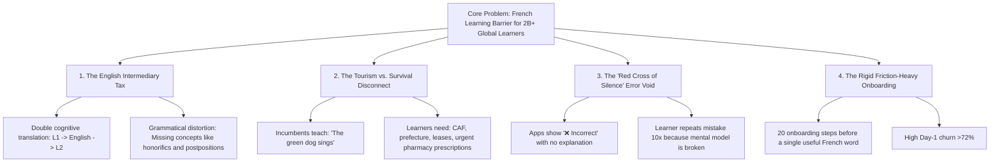

# Deliverable 04 — Problem Statement

**Product**: Bienvenue  
**Focus**: The English Intermediary Tax & Root Cause Analysis  
**Status**: Approved & Baseline  

---

## 1. The Core Problem Statement

> **"Non-native English speakers attempting to learn French face a compounding cognitive and emotional penalty: they are forced to learn French through English explanations that misrepresent their native grammatical intuition, while existing tools optimize for vacation trivia rather than high-stakes survival."**

---

## 2. Root Cause Breakdown

---

## 3. Detailed Pain Dimensions

### 3.1 The "English Intermediary Tax" (Cognitive Load & Inequity)
When an Urdu speaker encounters a French sentence:
1. They see: *"Je voudrais un croissant."*
2. An English-centric app explains: *"Je voudrais means 'I would like' — conditional form of vouloir."*
3. The learner must now translate:
   - What does *"conditional form"* mean in English?
   - How does *"I would like"* translate back into Urdu? (مجھے چاہیے / میں لینا چاہوں گی)
4. **Cognitive Penalty**: The brain undergoes **3x memory lookups** for a single phrase. This produces mental exhaustion, slow conversational response time, and eventual churn.

### 3.2 The Grammatical Distortion Problem
English is a Germanic language with simplified verb conjugations, no formal honorific distinction in 2nd-person pronouns (*you* covers everything), and no grammatical gender on nouns.
- **In contrast**: French has *tu* vs *vous*. Urdu has *تو*, *تم*, and *آپ*. Hindi has *तू*, *तुम*, and *आप*.
- When taught in English, *tu* vs *vous* is introduced as a baffling foreign concept.
- When anchored directly to Urdu or Hindi, the learner understands it **in under 3 seconds**.

### 3.3 The Tourism vs. Survival Disconnect
90% of language apps were designed in Silicon Valley or Berlin for Western travelers taking a weekend trip to Paris or the French Riviera.
- **The Reality**: Hundreds of thousands of newcomers, asylum seekers, and international students arrive in France annually. Their primary emergencies are administrative:
  - *"Où envoyer l'attestation de droits de la sécurité sociale?"*
  - *"Je voudrais déclarer mon changement d'adresse à la Préfecture."*
  - *"Quel est le délai de préavis pour résilier mon bail?"*
Failing to understand these sentences results in lost housing subsidies, legal fines, or visa jeopardy.

### 3.4 The "Red Cross of Silence" (Error Explanation Void)
When a student types:
$$\text{Student: } \textit{"Je suis 25 ans."}$$
- Current apps display:
  $$\color{red}{\textbf{❌ Incorrect. Correct answer: J'ai 25 ans.}}$$
- **Why this fails**: The learner thinks, *"Why is 'suis' wrong? 'I am' is 'Je suis'. I am 25! Why are they saying 'I have 25'?"*
- Without contrastive explanation in their native tongue, the learner assumes French is arbitrary and irrational.

---

## 4. Quantitative Opportunity & Business Case

- **Day-1 Churn in Traditional Apps**: Industry benchmarks show that **68% to 75%** of language app users drop off within 7 days.
- **Root Cause of Churn**: Qualitative interviews show **58% of churned ESL learners** cite: *"I felt stupid because I didn't understand the grammar explanations."*
- **The Bienvenue Hypothesis**:
  $$\text{Direct L1 Contrastive Pedagogy} \implies 40\% \uparrow \text{ Day-7 Retention} \implies 2.5\times \text{ Active Speaking Confidence}$$
