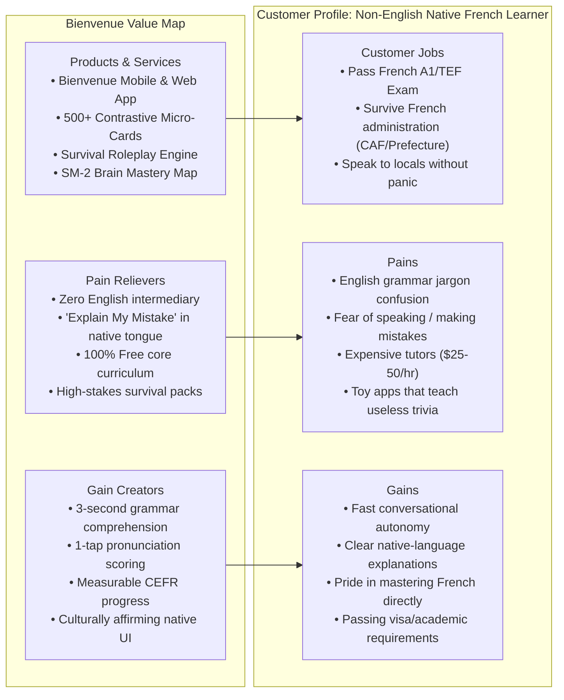

# Deliverable 05 — Value Proposition

**Product**: Bienvenue  
**Focus**: Value Proposition Canvas, Multi-Script Messaging Matrix & Positioning  
**Status**: Approved & Baseline  

---

## 1. Value Proposition Canvas

---

## 2. Multi-Script Messaging Matrix

To resonate deeply across cultural markets, Bienvenue avoids direct translation of American marketing slogans. Instead, each message is culturally and linguistically contextualized:

### 2.1 Urdu (اردو) — Pakistan & Global Diaspora
- **Hero Headline**: *فرانسیسی سیکھیں، اپنی زبان میں۔* (Learn French, in your language.)
- **Sub-headline**: *بغیر انگریزی کے سہارے — آسان اردو میں فرانسیسی گرامر، تلفظ اور روزمرہ گفتگو پر عبور حاصل کریں۔* (Without the crutch of English — master French grammar, pronunciation, and everyday conversation in simple Urdu.)
- **Key Call to Action (CTA)**: *ابھی مفت شروع کریں* (Start Free Now)
- **Trust Hook**: *پیرس کی زندگی، ویزا اور یونیورسٹی کے لیے بنائی گئی خاص ایپ۔* (The specialized app built for Paris life, visas, and university.)

### 2.2 Arabic (العربية) — North Africa & Middle East
- **Hero Headline**: *تعلّم الفرنسية بلغتك الأم — دون تعقيد.* (Learn French in your mother tongue — without complexity.)
- **Sub-headline**: *شروحات لغوية دقيقة تقارن بين قواعد العربية والفرنسية مباشرة، مع تدريب صوتي تفاعلي لحياتك اليومية في فرنسا.* (Precise linguistic explanations directly comparing Arabic and French grammar, with interactive voice training for your daily life in France.)
- **Key CTA**: *ابدأ التعلم مجاناً* (Start Learning Free)
- **Trust Hook**: *تجاوز عقبات الإدارة الفرنسية، التأشيرات والجامعات بكل ثقة.* (Overcome French administrative, visa, and university hurdles with confidence.)

### 2.3 Hindi (हिन्दी) — India & Global Francophone Aspirants
- **Hero Headline**: *अपनी भाषा में फ़्रेंच सीखें — बिल्कुल आसान और सीधा।* (Learn French in your own language — completely simple and direct.)
- **Sub-headline**: *बिना अंग्रेजी के भंवर में फंसे, हिंदी के माध्यम से फ़्रेंच व्याकरण, उच्चारण और TEF परीक्षा की तैयारी करें।* (Without getting trapped in English confusion, prepare for French grammar, pronunciation, and TEF exams through Hindi.)
- **Key CTA**: *मुफ़्त में शुरू करें* (Start for Free)

### 2.4 Spanish (Español) — Latin America & Spain
- **Hero Headline**: *Francés directo en tu idioma. Sin rodeos.* (Direct French in your language. No detours.)
- **Sub-headline**: *Aprovecha las raíces del español y domina el francés evitando los falsos amigos y errores comunes.* (Leverage Spanish roots and master French while avoiding false cognates and common traps.)
- **Key CTA**: *Comenzar Gratis* (Start Free)

### 2.5 English — International Working Language
- **Hero Headline**: *French, in your language. Learn French without learning English first.*
- **Sub-headline**: *A contrastive linguistic engine that maps French directly to your native syntax, phonology, and real-life survival needs.*
- **Key CTA**: *Get Started Free*

---

## 3. The 10x Value Proposition Pillars

| Dimension | Legacy Apps (Duolingo / Babbel) | **Bienvenue** |
|---|---|---|
| **Speed to Comprehension** | 10–15 minutes of trial-and-error per grammar rule | **<15 seconds** via direct native contrastive analogy |
| **Error Feedback** | "❌ Incorrect" | **Rich native diagnosis** highlighting L1 syntax interference |
| **Search Functionality** | None (Static sequential linear paths) | **Instant Micro-Learning Cards** with audio & 1-tap practice |
| **Situational Relevance** | "The green bear drinks wine" | **CAF, Préfecture, Leases, Pharmacie, Métro** |
| **Cost Barrier** | \$10–\$20/mo behind hard paywalls | **Free core A1/A2 forever** |
