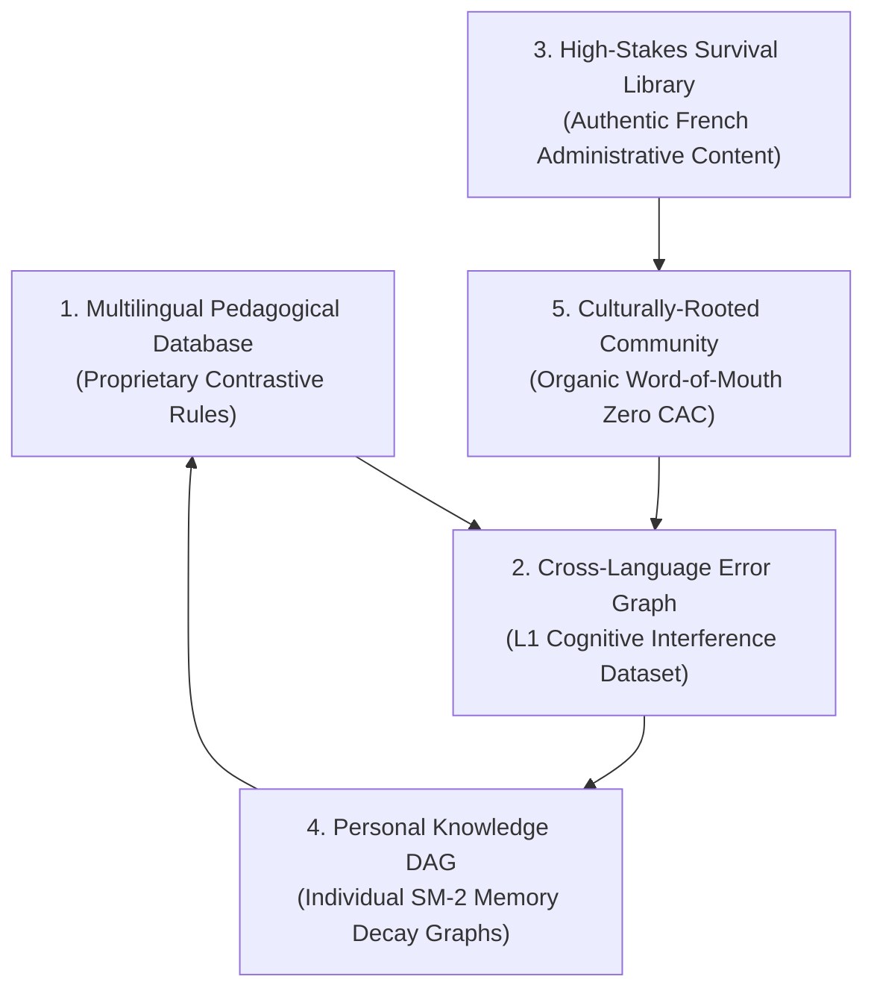

# Deliverable 06 — Product Strategy & Defensible Moats

**Product**: Bienvenue  
**Focus**: Long-Term Defensibility, Data Flywheel & Expansion Roadmap  
**Status**: Approved & Baseline  

---

## 1. The 5 Strategic Moats

In consumer technology, features can be copied; **proprietary pedagogical data flywheels and network effects cannot**. Bienvenue builds defensibility around 5 interlocking moats:

### Moat 1: The Contrastive Pedagogical Knowledge Graph
Duolingo and Babbel store vocabulary as isolated words or flat translation pairs ($Fr \leftrightarrow En$). Bienvenue structures French concepts as a graph connected to native cognitive adapters. Creating human-reviewed, certified contrastive explanations for Urdu, Arabic, Hindi, and Bengali requires specialized linguistic expertise that legacy English-first companies cannot easily duplicate without overhauling their underlying data pipelines.

### Moat 2: The Learner Error Intelligence Flywheel
Every time a user makes a mistake in Bienvenue (e.g. typing *"Je suis faim"* instead of *"J'ai faim"* or placing the verb at the end of a sentence), the system logs:
- Source language ($L_1$)
- Target phrase ($L_2$)
- Linguistic error classification (`COPULA_CONFUSION`, `SOV_WORD_ORDER`, `GENDER_MISMATCH`)
- Time to comprehension after reading the native explanation

$$\text{More Learners} \implies \text{Deeper Error Data} \implies \text{Sharper Native Explanations} \implies \text{Higher Retention} \implies \text{More Learners}$$

This creates a self-reinforcing intelligence layer: Bienvenue will know *statistically* that Urdu speakers confuse French gender on inanimate objects 4.2x more often than Arabic speakers, and automatically tunes the spaced repetition algorithm accordingly.

### Moat 3: The High-Stakes Survival Library
Traditional apps generate content for tourists. Bienvenue curates and regularly updates authentic administrative scenarios in collaboration with French social workers, student unions, and expat associations. This content is high-utility, emotionally resonant, and difficult for non-specialized apps to replicate.

### Moat 4: The Personal Mastery Graph (Switching Cost)
Each user’s progress is mapped to a detailed CEFR DAG with SuperMemo-2 memory decay metrics. A learner who has spent 60 days building their personalized French Brain Map faces high psychological and educational switching costs to abandon their active spaced-repetition queue for a generic app.

### Moat 5: Cultural Affinity & Zero-CAC Campus Flywheels
Because Bienvenue speaks to learners in their mother tongue with complete typographic elegance (authentic Nastaliq and Arabic RTL), it sparks intense organic pride and peer-to-peer sharing in international student groups, WhatsApp family circles, and diaspora Facebook groups.

---

## 2. Long-Term Expansion Strategy

### Phase 1: Beachhead (Months 1–6)
- **Target Language**: French (A1 Foundation + Survival).
- **Source Languages**: Urdu, Arabic, Hindi, Spanish, English.
- **Goal**: 10,000 active learners, validate Day-30 retention $>30\%$.

### Phase 2: Scale French to 25 Languages (Months 7–18)
- **Add**: Bengali, Punjabi, Turkish, Persian, Mandarin, Vietnamese, Portuguese, Russian, Swahili, Tagalog, etc.
- **Expand**: Full CEFR A2 and B1 tracks (DELF B1 / TEF Canada certification focus).
- **B2B Pilot**: University international offices and integration NGOs in France.

### Phase 3: Global Multilingual Infrastructure (Year 3+)
Transition from *"Bienvenue for French"* to the **Universal Multilingual Platform**:
$$\text{Any Source Language (100+)} \xrightarrow{\quad\text{Contrastive Engine}\quad} \text{Any Target Language (French, German, Spanish, Japanese, Arabic)}$$
At this stage, the company becomes an irreplaceable pedagogical infrastructure player.

---

## 3. Risk & Mitigation Matrix

| Risk Factor | Probability | Impact | Mitigation Strategy |
|---|---|---|---|
| **Duolingo adds native language support** | Medium | Medium | Duolingo's architecture relies on machine translation; they lack contrastive error diagnostics and survival content. Our depth in high-stakes use cases insulates our core user base. |
| **LLM Hallucination in dynamic explanations** | Low | High | Enforce Tier-1 human-curated rule cache for top 500 common mistakes; use strict few-shot contrastive prompt templates for dynamic queries. |
| **RTL Rendering and Typography bugs** | Medium | Medium | Comprehensive automated linguistic and visual regression tests across mobile and web viewports. |
| **High voice AI API costs** | Low | High | Utilize 100% free browser/device native speech synthesis (TTS) and Web Speech API (STT), removing variable cloud audio fees. |
