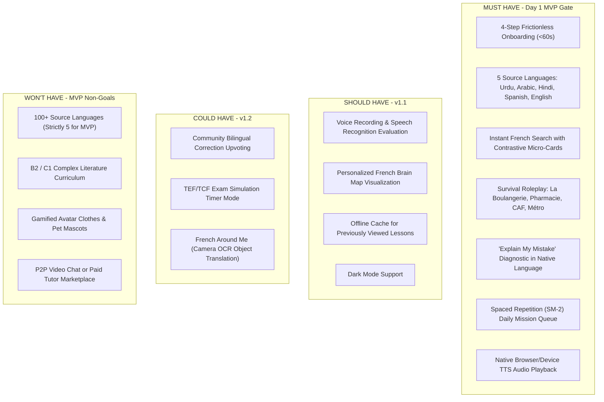

# Deliverable 07 — MVP Scope Definition & MoSCoW Prioritization

**Product**: Bienvenue  
**Focus**: Feature Boundaries, MoSCoW Matrix & Release Readiness Gates  
**Status**: Approved & Baseline  

---

## 1. Executive Scope Principle

> *"The fastest way to fail is to launch 100 mediocre language pairs with 50 half-baked features. The fastest way to win is to deliver 5 launch languages with flawless contrastive pedagogy, an addictive search-card engine, and real-world survival utility."*

---

## 2. MoSCoW Prioritization Matrix

---

## 3. Detailed MVP Feature Boundaries

| Module | In Scope for MVP (v1.0) | Explicit Non-Goals for MVP |
|---|---|---|
| **Curriculum & Levels** | Complete CEFR A1 foundation (greetings, essentials, *être/avoir*, gender, present regular verbs, survival situations). | A2/B1/B2/C1 curriculum tracks (deferred to Phase 2). |
| **Languages Supported** | Urdu (اردو), Arabic (العربية), Hindi (हिन्दी), Spanish (Español), English. | 100+ global languages. |
| **Search Engine** | Fast prefix & full-text search across French terms and native language keywords; renders interactive Micro-Card. | Complex semantic query parsing across full French legal treatises. |
| **Voice & Speech** | Native device speech synthesis (TTS) for all French words & Web Speech API STT for speech practice. | Proprietary custom neural voice cloning. |
| **Error Diagnostics** | 500+ curated high-frequency contrastive errors (age with *avoir*, nominal copula in Arabic, SOV word order). | Open-domain essays grading or thesis correction. |
| **Monetization** | 100% Free Core experience; clean upgrade preview for B2B/Premium. | Hard paywalls or intrusive pop-up advertisements. |

---

## 4. Release Readiness Quality Gates

An MVP release build is blocked from deployment unless it passes all 5 criteria:

1. **Gate 1: Linguistic Integrity**: Zero English words appear in explanations when the selected language is Urdu, Arabic, Hindi, or Spanish.
2. **Gate 2: Script & Layout Fidelity**: Right-to-Left (RTL) layout renders without horizontal scroll overflow or misaligned icons on Urdu and Arabic views.
3. **Gate 3: Search Latency**: Query to Micro-Card render time is under **50ms** for cached entries and under **250ms** for database lookups.
4. **Gate 4: Error Diagnostic Accuracy**: 100% of the top 20 canonical error scenarios (e.g. *"Je suis 25 ans"*, *"Je suis faim"*) correctly trigger the native contrastive explanation.
5. **Gate 5: Crash-Free Session Rate**: Greater than **99.5%** during automated E2E session runs.
