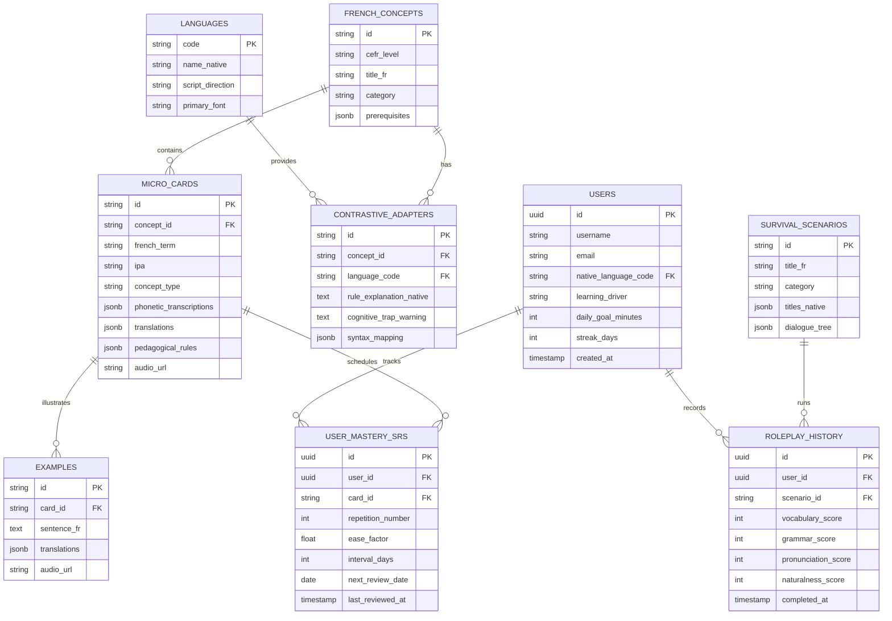

# Deliverable 13 — Database Schema & Data Models

**Product**: Bienvenue  
**Focus**: Relational ERD, PostgreSQL / SQLite Schemas & JSONB Specs  
**Status**: Approved & Baseline  

---

## 1. Entity Relationship Diagram (ERD)



---

## 2. PostgreSQL DDL (with SQLite Compatibility)

```sql
-- Languages Table
CREATE TABLE IF NOT EXISTS languages (
    code VARCHAR(5) PRIMARY KEY,
    name_native VARCHAR(64) NOT NULL,
    script_direction VARCHAR(3) DEFAULT 'ltr',
    primary_font VARCHAR(64) NOT NULL
);

-- Users Table
CREATE TABLE IF NOT EXISTS users (
    id VARCHAR(36) PRIMARY KEY,
    username VARCHAR(64) NOT NULL UNIQUE,
    email VARCHAR(128) UNIQUE,
    native_language_code VARCHAR(5) NOT NULL REFERENCES languages(code),
    learning_driver VARCHAR(32) DEFAULT 'moving_to_france',
    daily_goal_minutes INTEGER DEFAULT 10,
    streak_days INTEGER DEFAULT 1,
    created_at TIMESTAMP DEFAULT CURRENT_TIMESTAMP
);

-- French Knowledge Graph Concept Nodes
CREATE TABLE IF NOT EXISTS french_concepts (
    id VARCHAR(64) PRIMARY KEY,
    cefr_level VARCHAR(4) NOT NULL, -- A1, A2, B1
    title_fr VARCHAR(128) NOT NULL,
    category VARCHAR(64) NOT NULL,
    prerequisites TEXT -- JSON-encoded array of concept IDs
);

-- Micro-Learning Cards Table
CREATE TABLE IF NOT EXISTS micro_cards (
    id VARCHAR(64) PRIMARY KEY,
    concept_id VARCHAR(64) REFERENCES french_concepts(id),
    french_term VARCHAR(128) NOT NULL,
    ipa VARCHAR(64),
    concept_type VARCHAR(64),
    phonetics_json TEXT, -- JSON map: {"ur": "مے", "ar": "ميه", "hi": "मे"}
    translations_json TEXT, -- JSON map: {"ur": "لیکن", "ar": "لكن", "hi": "लेकिन"}
    rules_json TEXT, -- JSON map of contrastive pedagogical explanations
    examples_json TEXT, -- JSON array of bilingual sentence pairs
    audio_url VARCHAR(256)
);

-- SuperMemo-2 (SM-2) Spaced Repetition Table
CREATE TABLE IF NOT EXISTS user_mastery_srs (
    id VARCHAR(36) PRIMARY KEY,
    user_id VARCHAR(36) NOT NULL REFERENCES users(id),
    card_id VARCHAR(64) NOT NULL REFERENCES micro_cards(id),
    repetition_number INTEGER DEFAULT 0,
    ease_factor REAL DEFAULT 2.5,
    interval_days INTEGER DEFAULT 0,
    next_review_date DATE NOT NULL,
    last_reviewed_at TIMESTAMP DEFAULT CURRENT_TIMESTAMP
);

-- Pre-seeded Launch Languages
INSERT OR IGNORE INTO languages (code, name_native, script_direction, primary_font) VALUES
('ur', 'اردو', 'rtl', 'Noto Nastaliq Urdu'),
('ar', 'العربية', 'rtl', 'Amiri'),
('hi', 'हिन्दी', 'ltr', 'Noto Sans Devanagari'),
('es', 'Español', 'ltr', 'Inter'),
('en', 'English', 'ltr', 'Inter');
```
