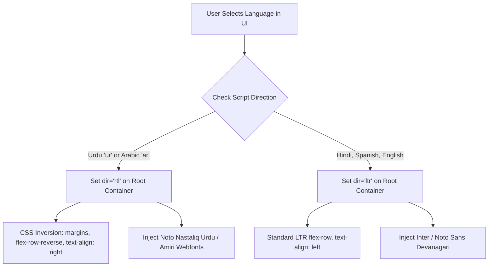

# Deliverable 15 — Multilingual & RTL Architecture

**Product**: Bienvenue  
**Focus**: Bi-Directional (RTL/LTR) Layout Engine, Script Typography & Translation Pipeline  
**Status**: Approved & Baseline  

---

## 1. Bi-Directional (RTL/LTR) Architecture

Supporting Urdu (اردو) and Arabic (العربية) alongside Latin and Devanagari scripts requires a **bidirectional layout engine** rather than a simple text translator.



### 1.1 Directional Mirroring Rules
1. **Flexbox & Grid Flow**: All horizontal containers use dynamic CSS classes `flex-row` (LTR) vs `flex-row-reverse` (RTL) or CSS logical properties (`margin-inline-start`, `padding-inline-end`).
2. **Icons & Chevrons**: Directional navigation arrows (e.g. `chevron-right` indicating "next step") automatically flip 180° when in RTL mode. Audio playback speaker icons and media buttons remain static.
3. **Bilingual Text Mixing (French in RTL context)**: When displaying a French example inside an Urdu paragraph, the French snippet is enclosed in `<span dir="ltr" class="font-sans">...</span>` tags to prevent punctuation inversion (e.g. ensuring periods and quotation marks do not jump to the wrong side of the sentence).

---

## 2. Multi-Script Typography Standards

| Language Code | Language Name | Script | Selected Webfont | Line-Height Multiplier | Typographic Reason |
|---|---|---|---|---|---|
| `ur` | اردو (Urdu) | Arabic (Nastaliq) | `Noto Nastaliq Urdu`, `Jameel Noori Nastaleeq` | **2.2** | Nastaliq has complex vertical stacking; standard 1.5 line height clips ascenders and descenders. |
| `ar` | العربية (Arabic) | Arabic (Naskh) | `Amiri`, `Noto Naskh Arabic` | **1.8** | Classical Naskh requires generous baseline clearance for diacritics (*harakat*). |
| `hi` | हिन्दी (Hindi) | Devanagari | `Noto Sans Devanagari` | **1.6** | Distinct *shirorekha* (top continuous line) requires clean horizontal alignment. |
| `es` | Español | Latin | `Inter`, system-ui | **1.5** | High-legibility modern sans-serif. |
| `en` | English | Latin | `Inter`, system-ui | **1.5** | High-legibility modern sans-serif. |

---

## 3. Localization Pipeline & Human-Review Workflow

```
[Curriculum Architect: French Concept Node Defined]
                      │
                      ▼
[Bilingual Certified FLE Translators / Native Educators]
  ├── Urdu Pack (Certified French Alliance Lahore Reviewer)
  ├── Arabic Pack (Certified FLE Rabat / Tunis Reviewer)
  ├── Hindi Pack (Certified Alliance Française Delhi Reviewer)
  └── Spanish Pack (Certified FLE Madrid Reviewer)
                      │
                      ▼
[Automated QA Integrity Script]
  ├── Verify 100% of JSON keys present
  ├── Assert zero Latin characters in native explanation strings
  └── Validate IPA phonetic format
                      │
                      ▼
[Production JSON Seed / Database Migration]
```
