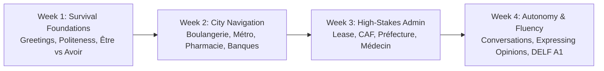

# Deliverable 16 — French CEFR A1 Curriculum Specification

**Product**: Bienvenue  
**Focus**: 30-Day High-Utility CEFR A1 Knowledge Graph & Survival Milestones  
**Status**: Approved & Baseline  

---

## 1. Curriculum Architecture: The 30-Day Survival Path

Traditional French courses spend 6 weeks teaching classroom objects and animal names. **Bienvenue's 30-Day Path** reorganizes CEFR A1 competencies around urgent real-life survival for newcomers, students, and immigrants:

---

## 2. Week-by-Week Modular Breakdown

### Week 1: Survival Foundations & Essential Verbs
- **Day 1**: The Golden Politeness Formula (*Bonjour, S'il vous plaît, Merci, Au revoir, Pardon*).
  - *Contrastive Focus*: French social obligation of saying *Bonjour* before asking any question.
- **Day 2**: Introducing Yourself (*Je m'appelle, Je viens de..., Je suis étudiant/ingénieur*).
- **Day 3**: The Dual Copula Trap: *Être* (Identity, Profession, Nationality).
  - *Contrastive Focus (Arabic)*: In Arabic, present copula is omitted; in French, *être* is strictly required.
- **Day 4**: The Dual Copula Trap: *Avoir* (Age, Bodily Needs, Possession).
  - *Contrastive Focus (Urdu/Hindi)*: *J'ai faim / J'ai 25 ans* (having hunger/age vs being).
- **Day 5**: Politeness Levels: *Tu vs Vous*.
  - *Contrastive Focus*: Maps directly to Urdu *تم vs آپ* and Hindi *तुम vs आप*.
- **Day 6**: Gender & Definite Articles (*Le, La, Les, Un, Une, Des*).
- **Day 7**: Weekly Review & First Speaking Checkpoint.

### Week 2: Everyday City Navigation & Commerce
- **Day 8**: Numbers 1 to 100 & Paying (*Combien ça coûte ? En espèces ou par carte ?*).
- **Day 9**: *La Boulangerie* (Ordering baguettes, croissants, *et avec ceci ?*).
- **Day 10**: *Le Supermarché & Le Marché* (Weights, fruits, vegetables, packaging).
- **Day 11**: *La Pharmacie* (Explaining pain: *J'ai mal à la tête / au ventre*, asking for prescriptions).
- **Day 12**: *Le Métro & Les Transports* (Buying tickets, Navigo pass, asking for directions: *Où est la ligne 4 ?*).
- **Day 13**: Basic Regular Verbs (*Manger, Habiter, Travailler, Parler*).
- **Day 14**: Survival Roleplay Simulation 1 (Bakery & Metro).

### Week 3: French Bureaucracy & Housing Survival
- **Day 15**: Signing a Lease (*Le bail, le loyer, les charges, le garant*).
- **Day 16**: Speaking to a Landlord (*Le chauffage ne marche pas, fuite d'eau*).
- **Day 17**: *La CAF & Les Aides au Logement* (Understanding terms: *allocataire, attestation, dossier*).
- **Day 18**: *Le Médecin & La Santé* (Making an appointment on Doctolib: *prendre rendez-vous, carte vitale*).
- **Day 19**: *La Préfecture & Les Visas* (Title of residence, renewal, required stamps: *titre de séjour, récépissé*).
- **Day 20**: The Essential Question Formula (*Est-ce que... ? Où, Quand, Pourquoi, Comment*).
- **Day 21**: Survival Roleplay Simulation 2 (Administrative Interview).

### Week 4: Everyday Autonomy & DELF A1 Checkpoint
- **Day 22**: Expressing Likes, Dislikes & Preferences (*J'aime, Je préfère, Je déteste*).
- **Day 23**: Making Plans & Meeting Friends (*On se voit à quelle heure ? Tu es libre samedi ?*).
- **Day 24**: Negation: The Sandwich Formula (*Ne ... pas, Ne ... jamais*).
- **Day 25**: Expressing Immediate Future (*Aller + Infinitif*: *Je vais partir, Nous allons manger*).
- **Day 26**: Expressing Recent Past (*Venir de + Infinitif*: *Je viens d'arriver*).
- **Day 27**: Ordering in a Restaurant with Special Dietary Requests (Halal, Vegetarian, Allergies).
- **Day 28**: Formal Email & SMS Etiquette (*Cordialement, Bien à vous, Bonjour Monsieur*).
- **Day 29**: Full DELF A1 Mock Oral Exam Simulation.
- **Day 30**: Graduation & 30-Day French Brain Map Milestone Certification.
