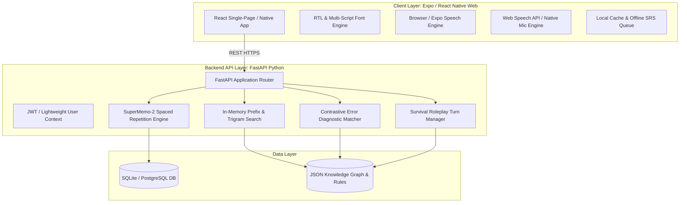

# Deliverable 19 — Full-Stack Technical Architecture

**Product**: Bienvenue  
**Focus**: System Architecture, API Contracts, Open-Source Infrastructure & Caching  
**Status**: Approved & Baseline  

---

## 1. End-to-End System Topology



---

## 2. Core REST API Contracts

### 2.1 Bilingual Instant Search
- **Endpoint**: `GET /api/search?q={query}&lang={lang_code}`
- **Latency Target**: $<50\text{ms}$
- **Response**:
```json
{
  "query": "mais",
  "lang": "ur",
  "results": [
    {
      "id": "card_mais_001",
      "french_term": "mais",
      "ipa": "/mɛ/",
      "phonetic_native": "مے",
      "translation_native": "لیکن",
      "concept_type": "Conjonction",
      "rule_summary": "دو متضاد باتوں کو جوڑنے کے لیے استعمال ہوتا ہے۔"
    }
  ]
}
```

### 2.2 Micro-Learning Card Detail
- **Endpoint**: `GET /api/card/{card_id}?lang={lang_code}`
- **Response**: Returns full card schema including phonetic guide, audio URL, deep contrastive rules, and bilingual examples.

### 2.3 Contrastive Error Diagnostic ("Explain My Mistake")
- **Endpoint**: `POST /api/pedagogy/explain-mistake`
- **Request Body**:
```json
{
  "user_sentence": "Je suis 25 ans.",
  "native_lang": "ur",
  "context": "age_expression"
}
```
- **Response**:
```json
{
  "is_error": true,
  "error_category": "COPULA_AGE_AVOIR",
  "explanation_native": "فرانسیسی میں عمر بتانے کے لیے 'avoir' (رکھنا) استعمال ہوتا ہے، نہ کہ 'être' (ہونا)۔",
  "corrected_fr": "J'ai 25 ans.",
  "rule_tag": "avoir_vs_etre_age",
  "phonetic_native": "ژے وینٹ سانک آں"
}
```

### 2.4 Survival Roleplay Turn
- **Endpoint**: `POST /api/survival/turn`
- **Request**: Scenario ID, current dialogue step, and user response (voice text or typed).
- **Response**: Clerk reply in French, native translation, and turn evaluation.

### 2.5 Spaced Repetition (SM-2) Update
- **Endpoint**: `POST /api/progress/srs-review`
- **Request**: Card ID, quality rating $q \in [0, 5]$.
- **Response**: Updated ease factor, new repetition count, and calculated next review date.

---

## 3. Deployment & Zero-Cost Infrastructure

- **Backend Runtime**: Containerized with lightweight `python:3.11-slim` Docker image.
- **Hosting**: Compatible with free-tier providers (Render, Fly.io, Railway, or Hugging Face Spaces) or self-hosted Docker on any \$4/mo VPS.
- **Frontend Hosting**: Static build deployable to Vercel, Netlify, or GitHub Pages at \$0.00 cost.
- **Zero API Dependency**: Default mode runs 100% locally with zero paid API keys.
