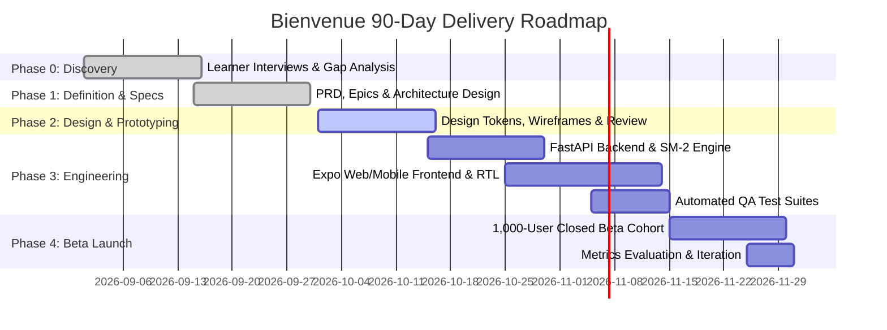

# Deliverable 20 — 90-Day Development Roadmap

**Product**: Bienvenue  
**Focus**: Sprint Schedule, Engineering Milestones & Resource Allocation  
**Status**: Approved & Baseline  

---

## 1. 90-Day Master Milestone Timeline

---

## 2. Sprint-by-Sprint Breakdown

### Sprint 1 (Days 1–15): Product Discovery & Linguistic Validation
- Conduct 50 qualitative learner interviews across target diaspora cohorts in France.
- Map top 500 contrastive error pairs across Urdu, Arabic, Hindi, Spanish, and English.
- Deliverables: Product Vision, Competitor Gap Analysis, Personas, Problem Statement.

### Sprint 2 (Days 16–30): Requirements & System Architecture
- Finalize PRD, Gherkin acceptance criteria, and user story estimations.
- Design PostgreSQL ERD, JSONB schemas, and FastAPI REST endpoints.
- Establish bilingual typographic and RTL styling rules.

### Sprint 3 (Days 31–45): UX Wireframes & Prototype Validation
- Build interactive clickable flows for Onboarding, Search Micro-Cards, and Survival Mode.
- Usability testing with 25 target learners (10 Urdu, 10 Arabic, 5 Hindi/Spanish).
- Validate that zero learners experience disorientation during the RTL transition.

### Sprint 4 & 5 (Days 46–75): Full-Stack Engineering & QA Automation
- **Backend**: FastAPI async endpoints, SQLite/PostgreSQL storage, curated contrastive rule engine, SuperMemo-2 scheduler.
- **Frontend**: Expo/React Native web app, dynamic RTL support, Web Speech API integration, native French TTS audio playback.
- **QA Automation**: End-to-end linguistic test suites, unit tests, and API latency assertions.

### Sprint 6 (Days 76–90): 1,000-User Closed Beta & Launch
- Deploy beta build to TestFlight, Android APK, and secure web staging.
- Onboard 1,000 international students and newcomers across Paris, Lyon, and Montreal.
- Track Weekly French Mastery Actions (WFMA), Day-7, and Day-30 retention.
