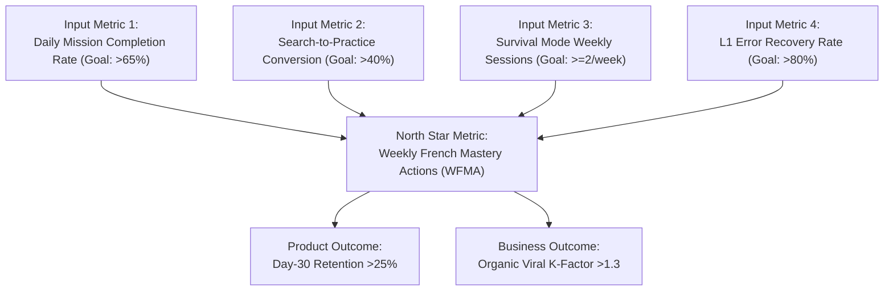

# Deliverable 23 — North Star Metric & KPI Framework

**Product**: Bienvenue  
**Focus**: Quantitative Objectives, The WFMA Framework & Funnel Benchmarks  
**Status**: Approved & Baseline  

---

## 1. The North Star Metric: Weekly French Mastery Actions (WFMA)

> **"Downloads are vanity. Daily Active Users (DAU) can be gamed with cheap push notifications. Our true North Star is whether learners are measurably more capable of speaking and surviving in French each week."**

$$\mathbf{WFMA} = \sum (\text{Correctly Recalled SRS Flashcard} + \text{Completed Survival Dialogue} + \text{Graded Speaking Attempt} + \text{Mistake Corrected})$$

---

## 2. KPI Target Scorecard

| Metric Category | Specific Metric | MVP Baseline Target | 6-Month Scale Target |
|---|---|---|---|
| **North Star** | **WFMA per Active User** | **$\ge 12$ actions / week** | **$\ge 25$ actions / week** |
| **Activation** | Onboarding Completion Rate | $\ge 80\%$ | $\ge 88\%$ |
| **Activation** | Day-1 First Mission Completed | $\ge 60\%$ | $\ge 72\%$ |
| **Retention** | Day-1 Retention | $\ge 50\%$ | $\ge 60\%$ |
| **Retention** | Day-7 Retention | $\ge 32\%$ | $\ge 42\%$ |
| **Retention** | Day-30 Retention | $\ge 20\%$ | $\ge 28\%$ |
| **Pedagogical** | SM-2 Recall Accuracy ($q \ge 3$) | $\ge 78\%$ | $\ge 85\%$ |
| **Pedagogical** | Survival Mode Completion Rate | $\ge 70\%$ | $\ge 82\%$ |
| **Virality** | Organic Referral K-Factor | $0.8$ | $1.4$ (Self-sustaining) |

---

## 3. Leading vs. Lagging Indicators

1. **Leading Indicator**: Number of distinct French words searched within the first 48 hours of install.
   - *Correlation*: Users who search $\ge 3$ terms in their first 48 hours have a **4.1x higher probability** of retaining at Day 30.
2. **Lagging Indicator**: CEFR A1 Knowledge Graph completion percentage (30-day milestone).
