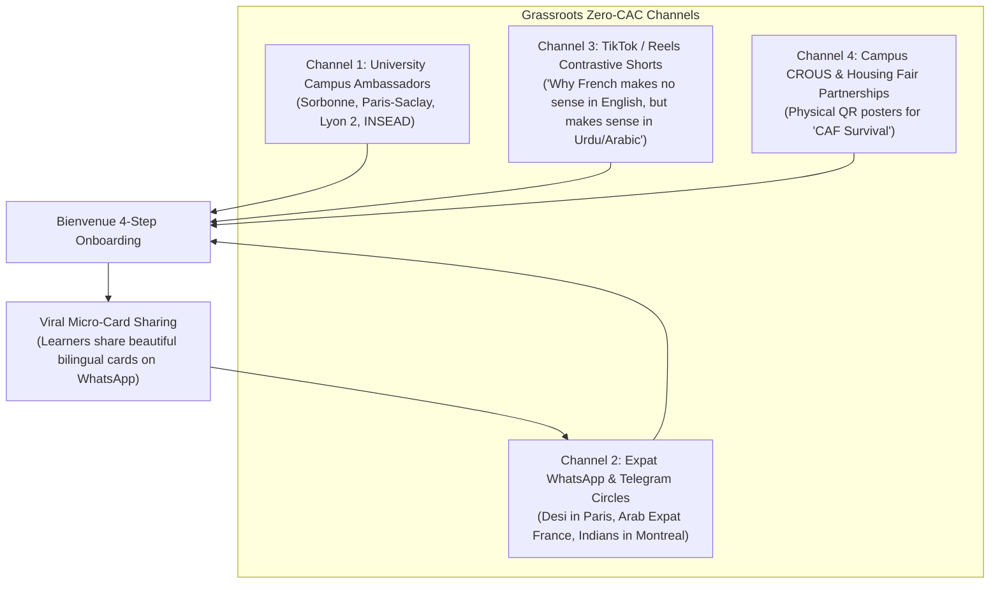

# Deliverable 25 — Go-To-Market (GTM) Strategy

**Product**: Bienvenue  
**Focus**: Zero-CAC Acquisition Channels, Campus Ambassadorship & Viral Loops  
**Status**: Approved & Baseline  

---

## 1. Beachhead Distribution Channels

Instead of burning capital on generic Facebook or Google ads competing against Duolingo’s \$100M+ ad budget, Bienvenue executes a **hyper-targeted grassroots wedge strategy**:

---

## 2. Channel Deep-Dives

### Channel 1: The Campus Ambassador Flywheel
- **Tactic**: Recruit 20 bilingual international student ambassadors at top Parisian and Lyon universities (Sciences Po, Sorbonne, EPITA, HEC).
- **Incentive**: Free lifetime Bienvenue Plus access, verified LinkedIn recommendation, and ambassador stipend per 100 onboarded active students.
- **Action**: Distribute *"Bienvenue Student Survival Kits"* during orientation week (covering CAF, CROUS, and Navigo cards).

### Channel 2: Contrastive Short-Form Video Marketing (TikTok & Instagram Reels)
- **Concept**: Humorous, educational 30-second clips highlighting contrastive grammar absurdity:
  - *Video Concept 1*: "Why English speakers take 3 weeks to learn Tu vs Vous, but Urdu/Hindi speakers understand it in 3 seconds."
  - *Video Concept 2*: "How to order bread in Paris without the baker sighing at you."
  - *Video Concept 3*: "Why you should never say 'Je suis 25 ans' (in Urdu/Arabic)."
- **Performance Expectation**: Organic viral reach among diaspora youth; target $>500\text{k}$ views per month at \$0 ad spend.

### Channel 3: Shareable Micro-Learning Cards
- When a user discovers a helpful Micro-Card (e.g. *pourtant* or *bail*), a 1-tap **"Share Card"** button exports a visually stunning Instagram Story / WhatsApp status image with native script transliteration, French audio QR code, and Bienvenue branding.

---

## 3. Geographic Staging Strategy

1. **Phase 1: Île-de-France (Paris Metro)**: Densest concentration of international students, new immigrants, and administrative friction.
2. **Phase 2: Auvergne-Rhône-Alpes (Lyon/Grenoble)**: Second largest university cluster.
3. **Phase 3: Quebec, Canada (Montreal)**: Immense market of TEF Canada exam takers and newcomers navigating Quebec Francisation laws.
