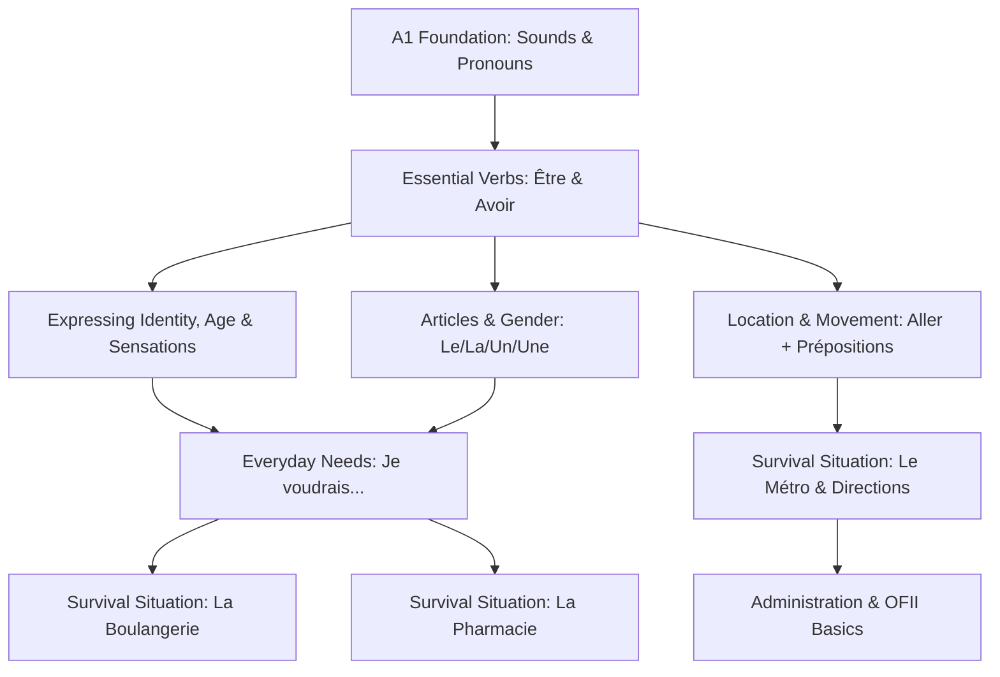
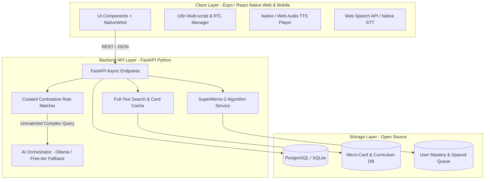

# Architectural Design Specification: Bienvenue (French in Your Language)

**Date**: 2026-09-08  
**Status**: Validated Design Specification  
**Product**: Bienvenue (formerly FRANÇAIS+)  
**Tagline**: *French in the language you understand.*  
**Primary Authors**: Product Management, QA & Systems Architecture  

---

## 1. Executive Summary & Product Vision

### 1.1 Vision & Mission
Current mainstream language platforms (Duolingo, Babbel, Busuu) operate on an implicit "English Intermediary Tax" or rely on shallow machine translations. An Urdu, Arabic, or Hindi speaker wanting to learn French is forced to translate French concepts into English first, or deal with explanations that ignore their native syntax, phonology, and common cognitive errors.

**Bienvenue** solves this by establishing a **direct, contrastive cognitive bridge** between French and the learner's native tongue.
$$\text{French} \longleftrightarrow \text{Learner's Native Language (Urdu, Arabic, Hindi, Spanish, English)}$$

No English detour. French grammar, idioms, nuances, and mistakes are explained with reference to the grammatical structures and idioms of the learner's own language.

### 1.2 Core Pillars & Strategic Wedges
1. **Direct Native-Bridge Pedagogy**: Contrastive grammar explaining French gender, verb conjugation, and sentence structure against the native language's specific syntax (e.g. SVO vs. SOV in Urdu/Hindi, nominal copula absence in Arabic).
2. **Survival & Bureaucratic French for New Arrivals**: High-stakes real-world simulations (CAF, Préfecture, OFII, leases, French administration, healthcare, bakeries, transit) rather than generic tourist phrases.
3. **Frictionless Search-as-a-Gateway**: "Search French in my language" yielding interactive **Micro-Learning Cards** with audio, native phonetic transliteration, contrastive rules, and 1-tap pronunciation scoring.
4. **"Explain My Mistake" Engine**: Pedagogical diagnostics that don't just say "❌ Wrong" but explain in the user's native language *why* the error occurred (e.g. why *avoir* is required for age instead of *être*).
5. **French Brain Mastery Map**: CEFR A1 knowledge graph tracking retention, active recall, and spaced repetition (SM-2) across recognition, recall, listening, and speaking.

---

## 2. The 28 PM Portfolio Deliverables (4-Volume Structure)

To establish an industry-grade Product Management portfolio showcasing QA, technical architecture, and product strategy rigor, the project is documented across 4 volumes under `docs/product/`:

```
docs/product/
├── README.md                              # Master Portfolio Case Study & Executive Dashboard
│
├── volume-1-strategy/                     # Strategic Discovery & Market Positioning
│   ├── 01-product-vision.md               # Vision, Core Tenets & Value Thesis
│   ├── 02-market-competitor-analysis.md   # Duolingo, Babbel, Busuu, Speak Competitive Matrix
│   ├── 03-user-personas.md                # Immigrant Sana (Urdu), Student Tariq (Arabic), Aspirant Rahul (Hindi)
│   ├── 04-problem-statement.md            # The English Intermediary Tax & Tourism vs Survival Gap
│   ├── 05-value-proposition.md            # Value Prop Canvas & Multi-script Messaging Matrix
│   └── 06-product-strategy-moat.md        # The 5 Moats: Contrastive error graph, local survival packs
│
├── volume-2-requirements/                 # Product Definition & UX Requirements
│   ├── 07-mvp-scope-definition.md         # MoSCoW Prioritization & Phase Boundaries
│   ├── 08-prd.md                          # Comprehensive Product Requirements Document (PRD)
│   ├── 09-user-stories.md                 # Epics & INVEST-compliant User Stories
│   ├── 10-acceptance-criteria.md          # Given-When-Then Acceptance Criteria
│   ├── 11-user-journeys.md                # Day-1 to Day-30 User Journey Maps
│   └── 12-information-architecture.md     # Sitemap, Taxonomy & Search-First IA
│
├── volume-3-architecture/                 # Pedagogical, Technical & AI Systems
│   ├── 13-database-data-model.md          # PostgreSQL / SQLite Relational & JSONB Schema
│   ├── 14-ai-architecture.md              # Contrastive Prompt Engineering & Guardrails
│   ├── 15-multilingual-architecture.md    # RTL/LTR Handling & Multilingual Translation Layer
│   ├── 16-french-a1-curriculum.md         # 30-Day Modular CEFR A1 Knowledge Graph
│   ├── 17-ui-ux-screen-specs.md           # Screen-by-Screen Specifications & State Diagrams
│   ├── 18-design-system.md                # Multi-script Typography, Color Tokens & Components
│   └── 19-technical-architecture.md       # Open-Source Full-Stack System Architecture
│
└── volume-4-execution-launch/             # QA, Operations, Analytics & GTM
    ├── 20-development-roadmap.md          # 90-Day Engineering Sprint & Delivery Plan
    ├── 21-qa-test-strategy.md             # Comprehensive E2E, Unit, & Linguistic Test Plan
    ├── 22-analytics-events.md             # Product Analytics Taxonomy (PostHog/Mixpanel)
    ├── 23-north-star-kpis.md              # Weekly French Mastery Actions (WFMA) & Funnels
    ├── 24-monetization-strategy.md        # Freemium Model & B2B University/OFII Licensing
    ├── 25-go-to-market-strategy.md        # Zero-CAC Campus & Expat Acquisition Engine
    ├── 26-beta-launch-strategy.md         # 1,000-User Closed Beta Framework & Feedback Loops
    ├── 27-investor-pitch-deck.md          # 12-Slide Venture Pitch Deck
    └── 28-product-portfolio-case-study.md # End-to-End Senior PM Case Study & Retrospective
```

---

## 3. Pedagogical Architecture & Contrastive Linguistic Engine

### 3.1 The CEFR A1 French Knowledge Graph
The curriculum is modeled as a Directed Acyclic Graph (DAG) of concept nodes. A learner cannot master complex past tense (*Passé Composé*) without first mastering the auxiliary nodes (*Avoir* and *Être*).



### 3.2 Contrastive Native-Language Adapters (5 Launch Languages)
Each node in the French Knowledge Graph is paired with contrastive linguistic rules for the 5 initial languages:

| Language | Code | Direction | Core Contrastive Focus |
|---|---|---|---|
| **Urdu (اردو)** | `ur` | RTL | SOV vs SVO word order, politeness levels (*Tu/Vous* $\leftrightarrow$ *تم/آپ*), gender concord differences, idiom mapping (*avoir faim* $\leftrightarrow$ *بھوک لگنا*). |
| **Arabic (العربية)** | `ar` | RTL | Copula omission (nominal sentences vs mandatory *être*), nasal vowel drills, /v/ vs /f/ distinction, dual-number differences. |
| **Hindi (हिन्दी)** | `hi` | LTR | Postpositions to prepositions (*में/से/पर* $\leftrightarrow$ *dans/de/à*), formality honorifics (*तू/तुम/आप* $\leftrightarrow$ *tu/vous*), SOV to SVO transformation. |
| **Spanish (Español)**| `es` | LTR | Romance cognate leverage, false friends (*actuellement* $\neq$ *actualmente*), mapping *ser/estar* onto unified *être*. |
| **English (English)** | `en` | LTR | Baseline CEFR, gendered nouns, contraction rules (*de le* $\rightarrow$ *du*), reflexive verbs. |

### 3.3 Micro-Learning Card Schema
```json
{
  "id": "card_mais_001",
  "french_term": "mais",
  "ipa": "/mɛ/",
  "phonetic_transcription": {
    "ur": "مے",
    "ar": "ميه",
    "hi": "मे",
    "es": "me",
    "en": "meh"
  },
  "concept_type": "conjunction_contrast",
  "native_meaning": {
    "ur": "لیکن",
    "ar": "لكن",
    "hi": "लेकिन",
    "es": "pero",
    "en": "but"
  },
  "pedagogical_rule": {
    "ur": "یہ لفظ دو متضاد باتوں کو جوڑنے کے لیے استعمال ہوتا ہے۔ اردو کی طرح فرانسیسی میں بھی یہ جملے کے درمیان آتا ہے۔",
    "ar": "تُستخدم للربط بين جملتين متناقضتين، وتأتي دائماً في وسط الجملة مثل 'لكن'.",
    "en": "Used to express contrast between two clauses. Placed directly between them."
  },
  "examples": [
    {
      "fr": "Je veux sortir, mais il pleut.",
      "ur": "میں باہر جانا چاہتی ہوں، لیکن بارش ہو رہی ہے۔",
      "ar": "أريد الخروج، لكنها تمطر.",
      "en": "I want to go out, but it's raining.",
      "audio_url": "/audio/fr/ex_mais_1.mp3"
    }
  ],
  "practice_prompt": {
    "type": "fill_in_blank",
    "sentence_fr": "Je suis fatigué ___ heureux.",
    "correct_answer": "mais"
  }
}
```

---

## 4. MVP Application Feature Scope & Screen Flows

The MVP focuses on 6 high-impact screens:
1. **Onboarding Flow (4 steps, <60s)**:
   - Native language selection (Urdu, Arabic, Hindi, Spanish, English) with instant UI script shift & RTL flip.
   - Purpose selection: Moving to France, University, TEF/TCF Exam, Work, Everyday Conversation.
   - Daily commitment: 5, 10, 20, 30 min.
   - Diagnostic check / Beginner placement.
2. **Home Screen ("Today's Mission")**:
   - Header with user greeting, streak counter, CEFR A1 mastery gauge.
   - Persistent Top Search bar: "Search French in your language..."
   - Daily 10-Minute Mission:
     - 5 Vocabulary SRS words to review
     - 1 Audio listening clip
     - 1 Speaking drill
     - 1 Contrastive grammar rule
3. **Instant Search & Micro-Learning Card Modal**:
   - Search by French word or native script keyword.
   - Instant card display with pronunciation audio, phonetics, native explanation, and interactive speaking attempt.
4. **Life Situation Mode (Survival Roleplay)**:
   - Guided roleplay scenarios: *La Boulangerie*, *La Pharmacie*, *Le Guichet RATP (Métro)*, *Le Bureau de la CAF*.
   - Free speech or text input with French AI clerk.
   - Multi-metric scorecard: Vocabulary, Grammar, Pronunciation, Naturalness.
5. **"Explain My Mistake" Diagnostic Component**:
   - Parses student errors (e.g. *Je suis 25 ans* $\rightarrow$ triggers `AVOIR_AGE_RULE`).
   - Native-language explanation highlighting native syntax interference.
   - 1-tap addition to spaced repetition queue.
6. **Brain Map & Spaced Repetition (SRS)**:
   - SuperMemo-2 (SM-2) memory decay scheduling.
   - Visual competency nodes showing green (mastered), yellow (in review), red (needs attention).

---

## 5. System Architecture & 100% Free / Open-Source Stack

To minimize operating costs and maximize accessibility, Bienvenue uses completely free and open-source infrastructure:



### 5.1 Component Details
- **Frontend**: **Expo (React Native)** with React Native Web support. One unified codebase running natively in modern web browsers, iOS simulators, and Android.
- **Styling**: NativeWind (Tailwind CSS) with custom theme tokens (French Navy `#1B2A4A`, Warm Cream `#FBF9F5`, Terracotta `#E05A47`, Gold `#D4AF37`).
- **Typography & RTL**:
  - Latin: `Inter`
  - Urdu: `Noto Nastaliq Urdu` (with automatic layout mirroring)
  - Arabic: `Amiri` / `Noto Naskh Arabic`
  - Hindi: `Noto Sans Devanagari`
- **Backend API**: **FastAPI (Python 3.11+)** with Uvicorn async server.
- **Database**: **PostgreSQL** with JSONB support (and zero-config **SQLite** for development and offline testing).
- **Speech & Audio**:
  - TTS: Native device synthesis (`SpeechSynthesis` API in browser; `expo-speech` on native). 100% free, natural French voices with zero third-party cloud audio billing.
  - STT: Browser Web Speech API (`webkitSpeechRecognition`) + whisper fallback.
- **AI Engine**:
  - Tier 1 (Free & Deterministic): 500+ curated contrastive rules running via local Python matcher in <5ms.
  - Tier 2 (Dynamic LLM): Compatible with local open-weights via **Ollama** (Llama 3 / Mistral 7B) or free-tier APIs (Gemini / Groq) with strict contrastive prompt guardrails.

---

## 6. Comprehensive QA Test Strategy & Verification Plan

Leveraging standard QA methodologies to guarantee linguistic accuracy and software resilience:

### 6.1 Test Suites
1. **Linguistic & Script Integrity Tests**:
   - Test RTL/LTR bidirectional rendering on Urdu and Arabic views.
   - Assert zero English leak when source language is Urdu, Arabic, Hindi, or Spanish.
   - Verify French diacritics (*é, è, ê, à, ç, œ*) are preserved through all API responses.
2. **Pedagogical Unit Tests**:
   - Validate SuperMemo-2 (SM-2) formula implementation:
     $$EF' = EF + (0.1 - (5 - q) \cdot (0.08 + (5 - q) \cdot 0.02))$$
   - Validate error classifier triggers correct contrastive rules (*être* vs *avoir* for age, physical feelings, and weather).
3. **Backend API Integration Tests**:
   - Pytest + HTTPX verifying response schemas, status codes, and search latency ($< 50\text{ms}$).
4. **End-to-End User Flow Tests**:
   - Complete Onboarding $\rightarrow$ Search $\rightarrow$ Micro-card practice $\rightarrow$ Roleplay dialogue $\rightarrow$ SRS update.

---

## 7. Next Steps: Phased Implementation Plan
Upon user signoff, execution proceeds via the `writing-plans` workflow to build the complete deliverable suite and functional MVP:
1. **Phase 1**: Author the 28 PM Portfolio Deliverables under `docs/product/`.
2. **Phase 2**: Build the FastAPI Backend, French Knowledge Graph database, and Contrastive Pedagogical Rule Engine.
3. **Phase 3**: Build the Expo React Native/Web Frontend with multi-script typography, RTL layout, search micro-cards, survival roleplay, and audio integration.
4. **Phase 4**: Run automated Pytest and UI verification suites, documenting all results in the final walkthrough.
